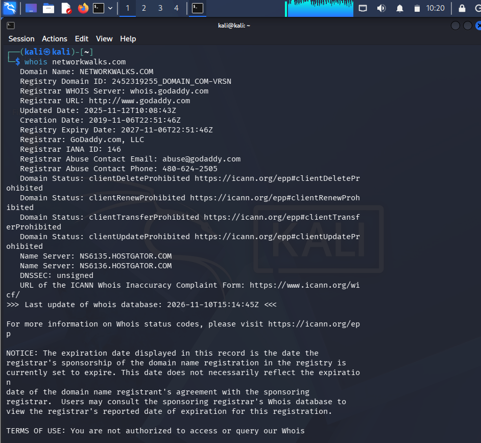
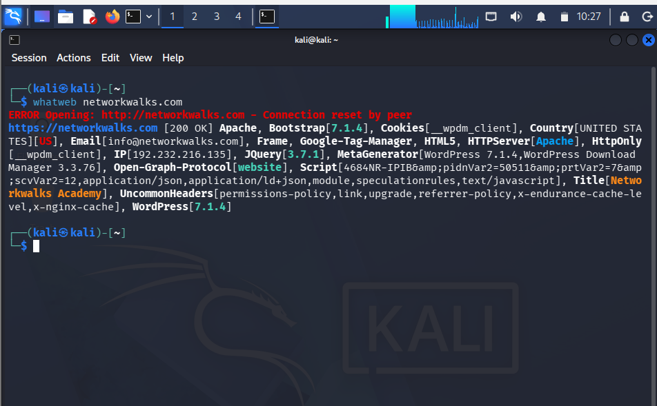
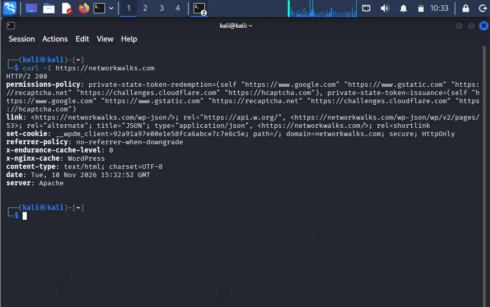
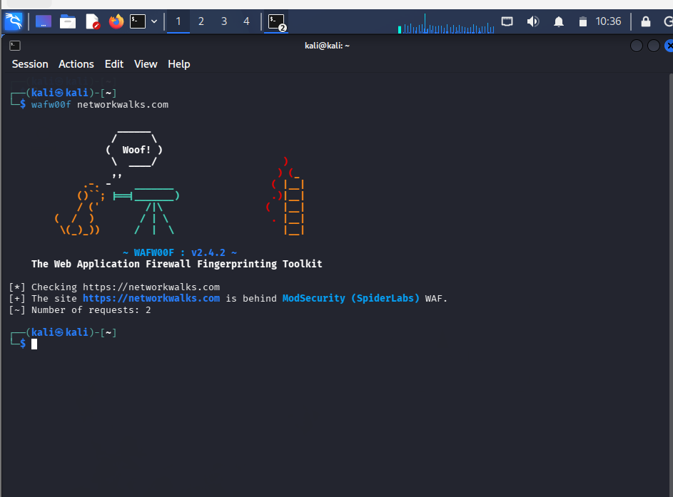
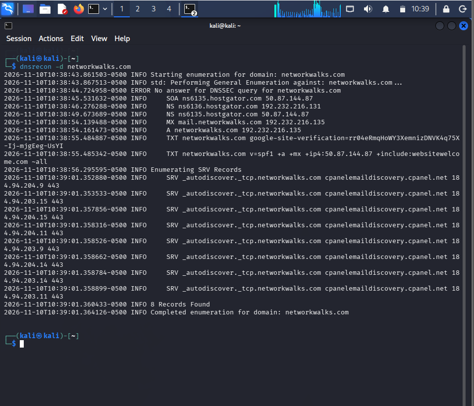
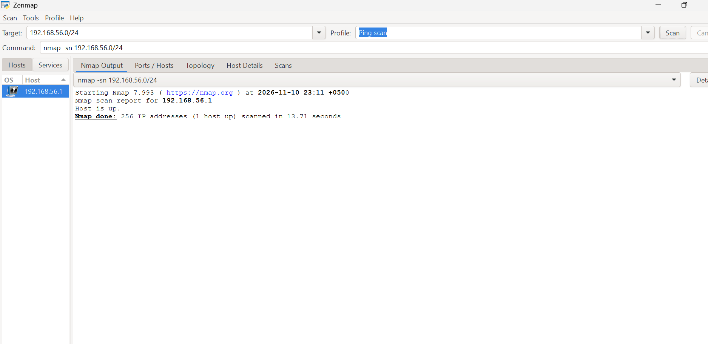
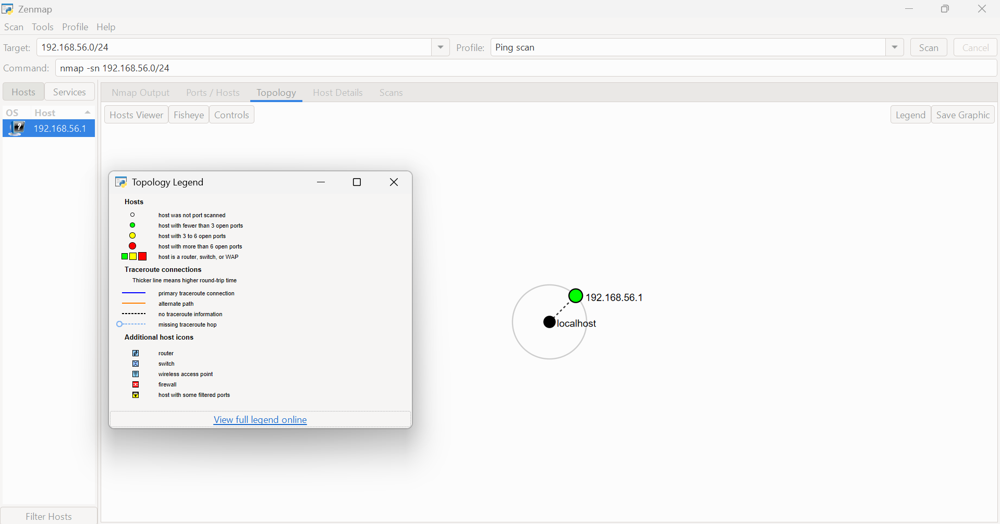
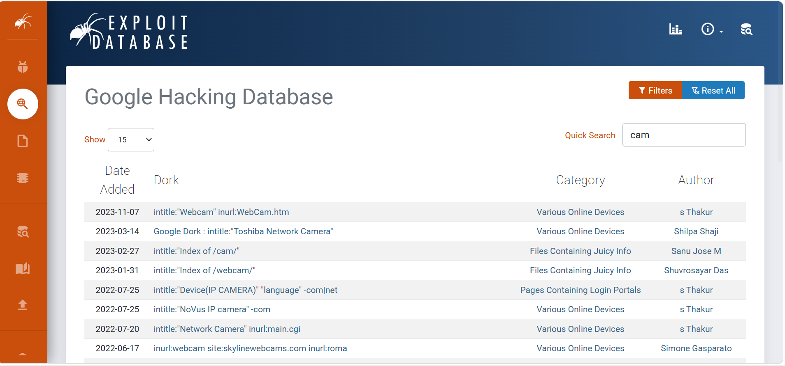

# Penetration Testing Report: Footprinting, Reconnaissance & Network Scanning

**W2-PM-FINAL | Cybersecurity & Ethical Hacking | Networkwalks (Week 2)**

| Field | Detail |
|---|---|
| **Pentester** | Kinza Abbasi |
| **Program** | Networkwalks Cybersecurity & Ethical Hacking Internship |
| **Date** | 10 November 2026 |
| **Modules completed** | W2-PM1 (Multiple Kali tools), W2-PM2 (GHDB), W2-PM5 (Zenmap) |
| **Targets** | 1. `networkwalks.com` (in scope) 2. My own local network (`192.168.56.0/24`) |
| **Phases covered** | Phase 1: Reconnaissance & Footprinting, Phase 2: Scanning & Network Discovery |

> **Full report:** [Kinza_Abbasi_Week2_Pentest_Report.pdf](Kinza_Abbasi_Week2_Pentest_Report.pdf) (Word version: `.docx`)

## Liability Disclaimer
These activities were performed only on systems I own or where written permission exists. All material is for education and research. Unauthorised access is a crime in most countries.

## Summary
| Kali tools used | GHDB dorks documented | Math e-books verified | Live hosts (own LAN) | Exploits attempted |
|:-:|:-:|:-:|:-:|:-:|
| 6 | 10 | 10 | 1 | 0 |

## W2-PM1: Footprinting `networkwalks.com`
| Tool | Command | Key finding |
|---|---|---|
| WHOIS | `whois networkwalks.com` | GoDaddy registrar, created 2019-11-06, registrar lock, privacy service, HostGator + DomainControl name servers, DNSSEC unsigned |
| WhatWeb | `whatweb networkwalks.com` | Apache, WordPress 7.1.4, WP Download Manager 3.3.76, jQuery 3.7.1, IP 192.232.216.135 |
| Nslookup | `nslookup networkwalks.com` | Resolves to 192.232.216.135 |
| Curl | `curl -I https://networkwalks.com` | HTTP/2 200, `/wp-json/` advertised, Secure + HttpOnly cookie, several security headers not seen |
| Wafw00f | `wafw00f networkwalks.com` | ModSecurity (SpiderLabs) WAF detected |
| DNSRecon | `dnsrecon -d networkwalks.com` | SOA/NS (HostGator), A + MX on same IP, SPF `~all`, 8 SRV autodiscover records |

## W2-PM2: GHDB footprinting
- **Task 1 (cameras):** 10 dorks from GHDB were documented. **No exposed camera feed was opened**, because third-party devices are outside the authorised scope.
- **Task 2 (math e-books):** 10 OpenStax PDFs located with `site:openstax.org filetype:pdf "<title>"` and verified (Elementary Algebra, Intermediate Algebra, College Algebra, Algebra and Trigonometry, Precalculus, Calculus Vol. 1-3, Introductory Statistics, Prealgebra).

## W2-PM5: Zenmap network scanning
| Item | Result |
|---|---|
| Local IP / subnet | `192.168.56.1` / `192.168.56.0/24` (VirtualBox Host-Only) |
| Command | `nmap -sn 192.168.56.0/24` (Ping scan) |
| Live hosts | 1 (`192.168.56.1`), 256 IPs scanned in 13.71 s |
| MAC (live host) | `0A-00-27-00-00-08` |
| Topology | Exported as PDF via Zenmap, Save Graphic |

## Risk Overview (observations, not confirmed vulnerabilities)
| # | Finding | Level |
|---|---|---|
| 1 | Web technology and version disclosure | Medium |
| 2 | Missing browser security headers | Medium |
| 3 | Email authentication gaps (SPF soft fail, DNSSEC unsigned) | Medium |
| 4 | Server IP and shared hosting visible | Low |
| 5 | REST API advertised | Low |
| 6 | WAF product identifiable | Low |
| 7 | Public exposure through search engines (GHDB) | Medium |
| 8 | Local host visibility | Low |

## Repository structure
```
.
├── README.md
├── Kinza_Abbasi_Week2_Pentest_Report.pdf
├── Kinza_Abbasi_Week2_Pentest_Report.docx
└── screenshots/   (evidence: Kali tools, GHDB, OpenStax PDFs, Zenmap)
```

## Screenshots (evidence)
| | |
|---|---|
|  |  |
|  |  |
|  |  |
|  |  |

---
**Author:** Kinza Abbasi | Networkwalks Cybersecurity Program | Week 02
